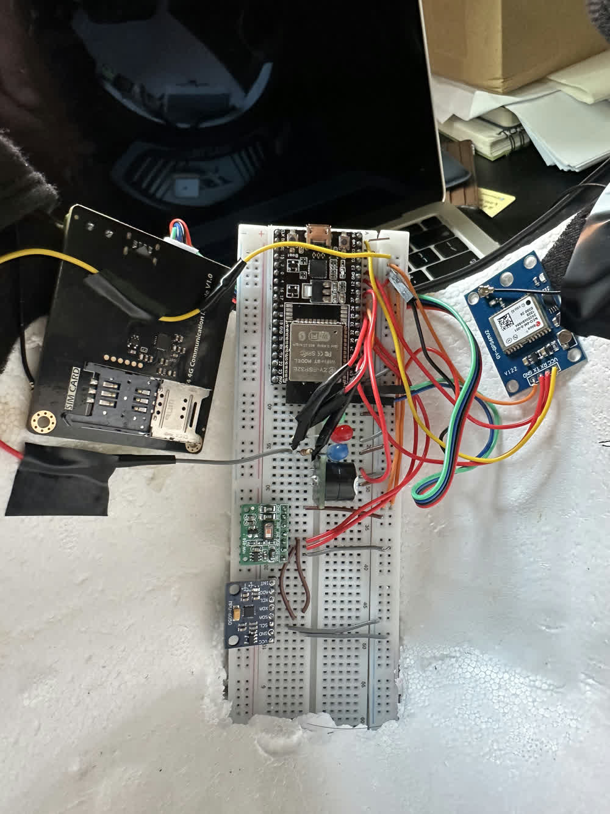
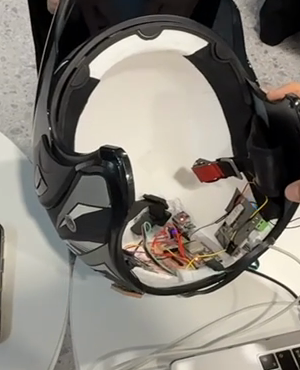
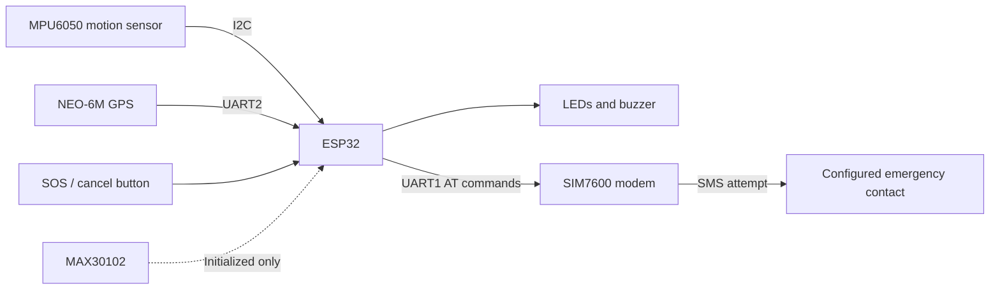
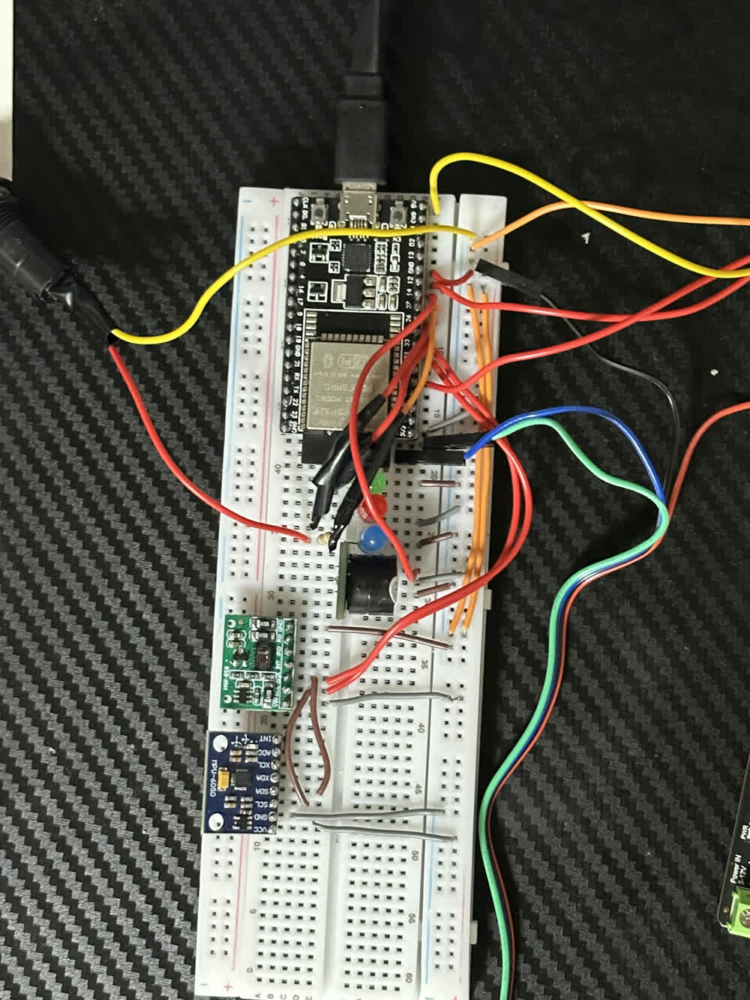

# Smart Helmet IoT

**ESP32 · Arduino C++ · MPU6050 · NEO-6M GPS · SIM7600**

A physical helmet prototype exploring motion-triggered emergency alerts. The firmware detects acceleration or rotation above configurable thresholds, runs a cancellable SOS countdown, and attempts to send an SMS with a GPS map link through a SIM7600 modem.

**Status:** Arduino firmware compiles for a generic ESP32 board. Hardware demonstration media is available; controlled detection accuracy and end-to-end SMS delivery results are not yet recorded in this repository. This is an experimental prototype, not a certified protective or emergency-response device.

<p align="center">
  
  
</p>

## How it works

1. Read the MPU6050 acceleration and angular velocity, approximately once per second while idle.
2. Start an SOS countdown if acceleration magnitude reaches **1.2 g** or angular velocity magnitude reaches **150°/s**.
3. Flash the red LED and drive the buzzer through ten nominal one-second countdown cycles. A button press cancels the countdown.
4. After the countdown, sound the buzzer for another two seconds and attempt an emergency SMS.
5. Include coordinates and a Google Maps link when a GPS fix is available; otherwise include `GPS: NO FIX`.



The [architecture and limitations](docs/architecture.md) explain timing, state transitions and failure behavior.

## What the firmware implements

| Capability | Current implementation |
| --- | --- |
| Motion thresholds | Acceleration and gyroscope magnitudes; either threshold starts SOS |
| Countdown cancellation | Active-low button with a 50 ms debounce check |
| Manual SOS entry | Present, with a known button/cancel interaction described below |
| GPS parsing | NEO-6M UART input parsed by TinyGPSPlus |
| Emergency SMS | GSM text mode, prompt timeout, `+CMGS:` and `+CMS ERROR` handling |
| Local feedback | Serial diagnostics, red/green LEDs and buzzer |
| MAX30102 | Initialization and configuration only; no BPM or SpO₂ calculation |

There is no mobile application, cloud backend, camera integration, Bluetooth service, Firebase or Flutter implementation in this firmware.

## Build and configure

1. Install ESP32 board support in Arduino IDE.
2. Install **Adafruit MPU6050**, **Adafruit Unified Sensor**, **Adafruit BusIO**, **SparkFun MAX3010x Pulse and Proximity Sensor Library**, and **TinyGPSPlus**.
3. Open [`firmware/smart_helmet/smart_helmet.ino`](firmware/smart_helmet/smart_helmet.ino). Select the board matching your hardware; the recorded compilation used **ESP32 Dev Module**.
4. Copy `secrets.example.h` to `secrets.h` in the same sketch directory. Set `EMERGENCY_PHONE_NUMBER` to an intended test recipient in international format. Keep this file private.
5. Review the [pin map](hardware/wiring.md), module power requirements and [bench test plan](docs/testing.md) before uploading.
6. Open Serial Monitor at **115200 baud**. Public firmware builds with an empty recipient and refuses to send SMS until configured locally.

Command-line equivalent:

```sh
arduino-cli compile --fqbn esp32:esp32:esp32 firmware/smart_helmet
```

See [build verification](docs/build.md) for the exact locally verified versions and memory usage. Compilation does not establish hardware operation or alert reliability.

## Hardware

| Component | Role |
| --- | --- |
| ESP32 | Main controller; two UARTs and shared I2C |
| MPU6050 | Acceleration and angular velocity |
| NEO-6M | GPS coordinates and satellite count |
| SIM7600 | SMS through AT commands |
| MAX30102 | Initialized sensor; health algorithms remain unimplemented |
| Push button | SOS entry and cancellation |
| Red/green LEDs and buzzer | Local indication |

The [wiring document](hardware/wiring.md) maps the firmware pins. Supply voltages, modem power design and breakout details must be checked against the exact physical modules.

<p align="center"></p>

## Known limitations

- **Manual SOS can cancel itself:** the same held-low button starts SOS and is immediately read as cancellation. A distinct press/release interaction needs implementation and testing.
- Motion sampling is approximately 1 Hz outside SOS and stops during the blocking alert flow. Brief impacts may be missed; detection accuracy is unmeasured.
- GPS validity is latched once a fix is received. There is no age limit, so an old location may be sent.
- Initialization return values do not gate the green ready LED. A ready message does not prove every module is healthy.
- A modem `+CMGS:` response is treated as submission success, not recipient delivery confirmation. There is no retry or cooldown after an alert.

See [the test plan](docs/testing.md) for the checks required before reporting these features as validated.

## Presentation

A 12-slide Korean portfolio presentation based on the submitted firmware and prototype photos. This revised edition replaces unsupported implementation and testing claims from the original presentation and omits personal location data.

- [View the presentation as PDF](docs/presentation/smart-helmet-presentation.pdf)
- [Download the editable PowerPoint presentation](docs/presentation/smart-helmet-presentation.pptx)

## Repository guide

```text
firmware/smart_helmet/  Arduino sketch and public configuration template
hardware/              Firmware-derived connections
docs/                  Architecture, build verification and bench test plan
images/                Reviewed prototype photos
```

Original photos, video, poster and private settings are excluded from publication. The supplied poster contains broader feature claims than this code implements. The full video includes phone screens and has not been published; the helmet-only still above is extracted from it.

## 한국어 소개

ESP32 기반 스마트 헬멧 시제품입니다. MPU6050의 가속도와 회전 속도를 이용해 설정된 임계값을 감지하고, 취소 가능한 SOS 카운트다운 후 SIM7600으로 긴급 SMS 전송을 시도합니다. GPS 수신 정보가 있으면 위치 링크를 포함합니다. 현재 저장소의 코드는 ESP32용 컴파일을 확인했으며, 실제 감지 정확도와 SMS 수신 결과는 별도 검증이 필요합니다.

## Author and reuse

Portfolio maintained by [Olimjon Tojiboev](https://github.com/olimjon03). No open-source license is granted in this repository at present.
