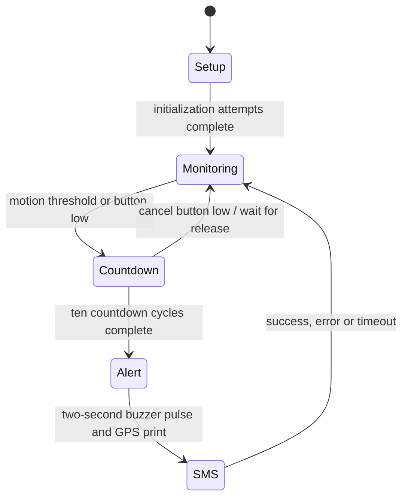

# Firmware architecture

The sketch uses a single Arduino loop with blocking SOS and modem operations. It does not use a scheduler, cloud service or mobile-app transport.

## Monitoring

`readGPS()` consumes available UART bytes on each loop. `printSensors()` reads the MPU6050 approximately once per second. It computes the acceleration vector magnitude in g and angular velocity vector magnitude in degrees per second. Thresholds use an OR condition, not a confirmed crash classifier.

GPS diagnostics are printed approximately every five seconds. These schedules are delayed whenever an SOS or modem operation blocks execution.

## Countdown and cancellation

The countdown runs ten cycles, each containing nominal 500 ms on and 500 ms off periods. GPS parsing and cancellation checks run during those periods. Debouncing and serial output can lengthen the elapsed time.

GPIO27 has two roles. In the current source, a manual press calls `startSOS()` while the button is still held. `cancelPressed()` then sees the same press and cancels it. The published version preserves this behavior and documents it rather than claiming a validated manual SOS flow.

## SMS behavior

After countdown completion, the firmware drives the red LED and buzzer for two seconds, then attempts SMS submission. It waits up to ten seconds for the `>` prompt and up to thirty seconds for a result after Ctrl-Z. A `+CMGS:` response returns success; a `+CMS ERROR` or timeout returns failure. The caller does not retry or persist the result.

Coordinates are included only when `gpsValid` is true. This flag is never reset after a fix and the code does not check location age. `GPS: NO FIX` is sent when no valid fix has been acquired.

## Readiness and recovery

MPU6050 and MAX30102 initialization return booleans, but `setup()` ignores those values. Modem initialization prints ready after issuing commands without enforcing their responses. The green LED therefore indicates setup completion, not full subsystem health.

After an alert, `sosActive` is cleared. Persistent movement can trigger another alert; no cooldown or acknowledgement state exists.

## Publication changes

The original recipient number was removed. `config.h` reads an optional private `secrets.h`; otherwise the number defaults to an empty string. `sendSMS()` rejects that empty value. Excess blank lines were reduced. Sensor thresholds, timing and alert logic were otherwise preserved.
